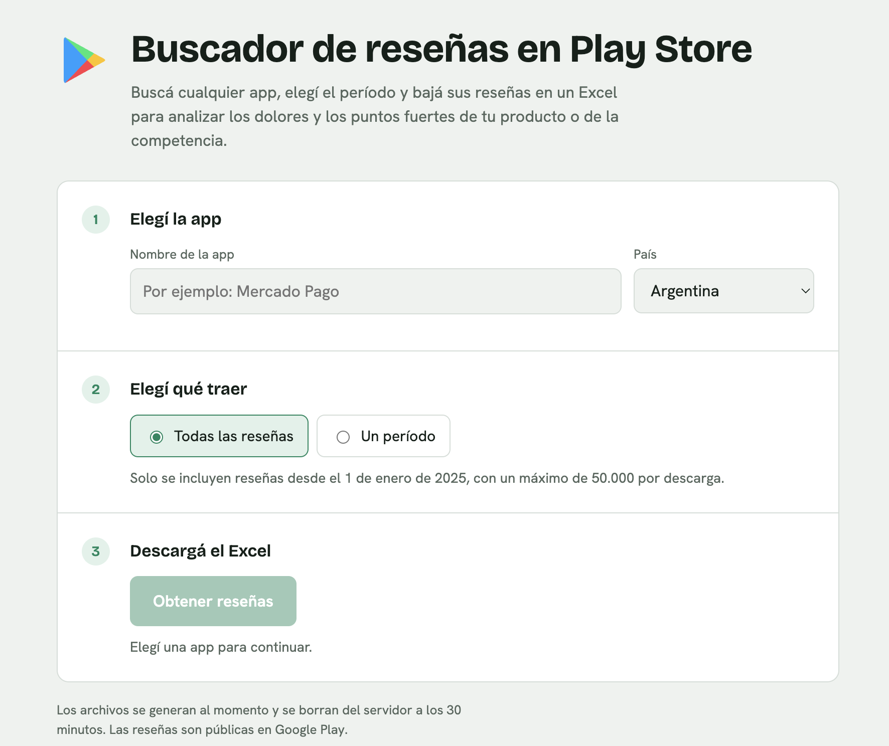
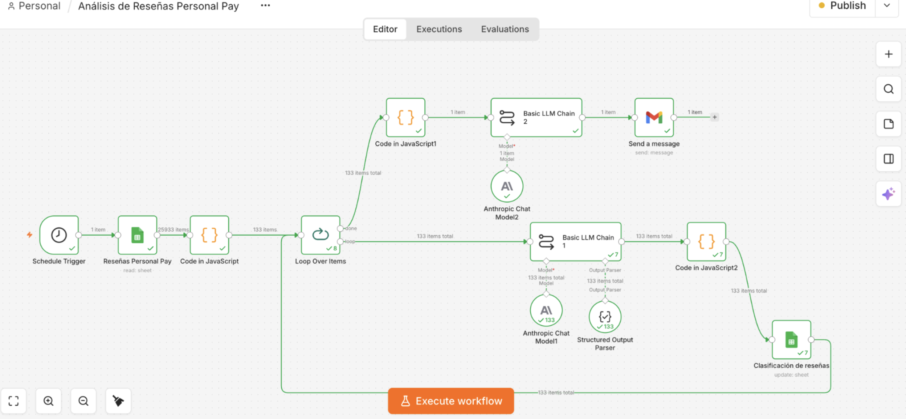

# Play Store Review Finder

Search any app on Google Play and download its reviews as an Excel file, for any country and any period. A weekly job also keeps a Google Sheet up to date, which feeds an n8n workflow that classifies the reviews with AI and emails an opportunities report.

**Live demo: https://mentoriaittude-buscadordecalificaciones.mepzhl.easypanel.host/**



## The problem

Reading reviews by hand on the Play Store is slow: endless scrolling, and no way to export them. This tool turns them into structured data, so product, customer experience and competitive intelligence teams can see the pain points and strengths of their own product and of competitors without manual work.

## What it does

1. **Public web app** (`app/`): search an app, pick a country, choose "all reviews" or a date range, and download an Excel file.
   - Reviews since 1 January 2025, up to 50,000 per download.
   - 3 concurrent downloads at most; generated files are deleted after 30 minutes.
2. **Weekly sync** (`app/scheduler.py`, `core/sheets.py`): every Sunday at 22:00 it appends the last 14 days of new Personal Pay reviews to a Google Sheet. It never deletes or modifies existing rows, so the category and sentiment columns filled in by the n8n flow stay intact.
3. **AI analysis (n8n)**: a separate n8n workflow turns the Sheet into a weekly report (details below).

## Weekly AI report (n8n)

Every Monday at 09:00, the workflow reads the last week of reviews from the Google Sheet and uses Claude (via n8n's LLM chain nodes) to classify each one by category and sentiment (positive, neutral or negative). The structured output is validated with a parser and written back to the Sheet. Once all reviews are classified, they are grouped and a second LLM step writes a report with the main opportunities, backed by 2 or 3 verbatim reviews, and sends it by email.



Reading hundreds of reviews by hand every week is slow, and the conclusions depend on who reads them. The workflow does it consistently, so the team gets a summary each Monday of what bothers users and what is most urgent.

## Tech stack

Python · FastAPI · Uvicorn · openpyxl · Google Sheets API (gspread) · Docker · n8n · Easypanel

Reviews come from [`google-play-scraper`](https://github.com/JoMingyu/google-play-scraper), which uses Google Play's internal service. It is not an official API.

## Design decisions

- **Shared core.** The web app and the weekly sync both use `core/`, so search, download and export logic exists once.
- **Append-only sync.** The sync only adds new rows and skips ones that already exist (it logs the counts read, new and already existing). Re-running it is safe, and downstream columns written by n8n are never overwritten.
- **Bounded resource use.** Caps on reviews per download and on concurrent downloads, plus automatic file cleanup, keep a small public server stable.
- **Single instance.** The scheduler runs inside the app process, so running several replicas would execute the sync several times.

## How it was built

Developed with Claude Code, following the WAT framework (Workflows, Agents, Tools): markdown SOPs in `workflows/` define what to do, the agent coordinates, and deterministic Python scripts in `tools/` do the work.

## Run locally

```bash
python3 -m venv .venv && .venv/bin/pip install -r requirements.txt
.venv/bin/python -m uvicorn app.main:app --port 8001
```

Open http://localhost:8001. To test the sync without writing anything: `python tools/weekly_sync.py --dry-run`.

## Project structure

```
app/        web server (FastAPI), UI and weekly sync
core/       review search and download, Excel and Google Sheets
tools/      command-line scripts
workflows/  SOPs (WAT framework)
docs/       screenshots
```

## Deploy on Easypanel

1. **Google service account** (one time): in Google Cloud, enable the *Google Sheets API*, create a service account, generate a JSON key and share the Sheet with the account's email as **editor**.
2. In Easypanel, create an app from this GitHub repository (build with the `Dockerfile`).
3. App port: **8000**.
4. Environment variables (see `.env.example`):

   | Variable | Value |
   |---|---|
   | `TZ` | `Europe/Berlin` |
   | `WEEKLY_SYNC` | `1` |
   | `SPREADSHEET_ID` | Sheet ID (the long part of its URL) |
   | `WORKSHEET_NAME` | `PlayStore` |
   | `GOOGLE_SERVICE_ACCOUNT_JSON` | service account JSON content, on one line |

   Without `WEEKLY_SYNC` and `SPREADSHEET_ID` the web app still works, but there is no sync.
5. Domain: assign one from the *Domains* tab.
6. Instances: **one only** (see design decisions).

The result of each sync is written to the app logs (`[sync semanal ...] leídas X, nuevas Y, ya existían Z`).
